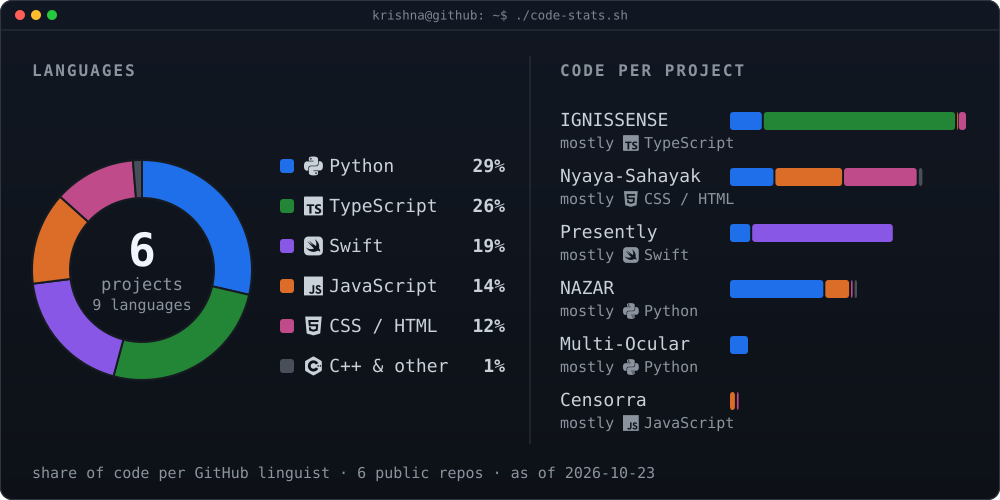
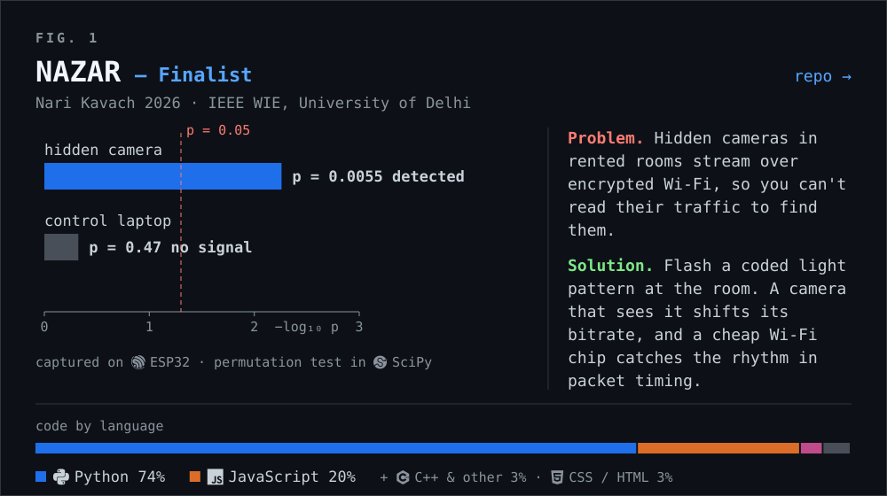
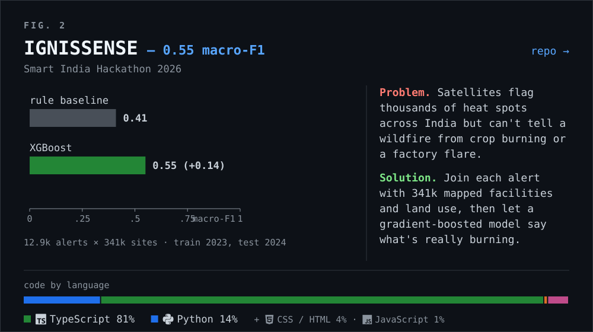
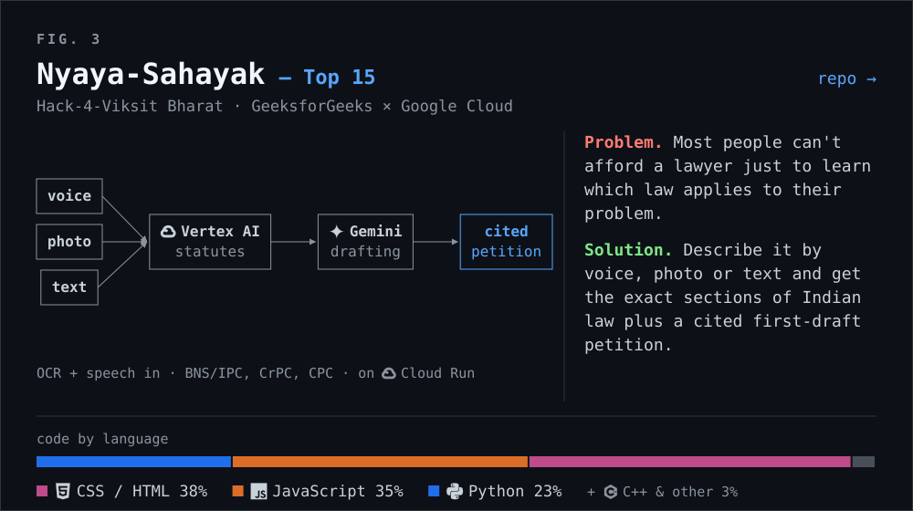
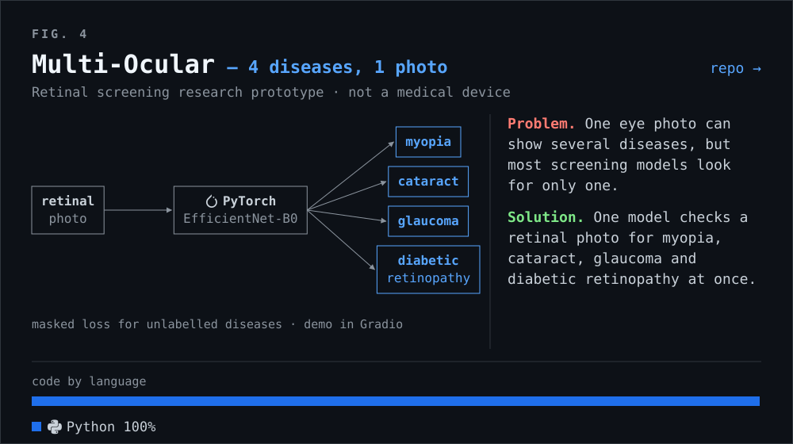
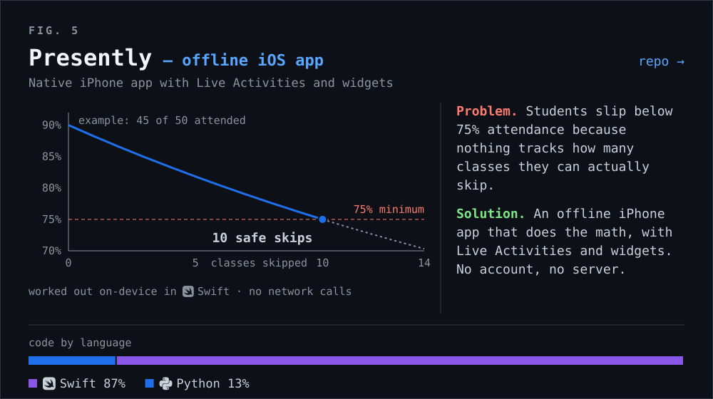
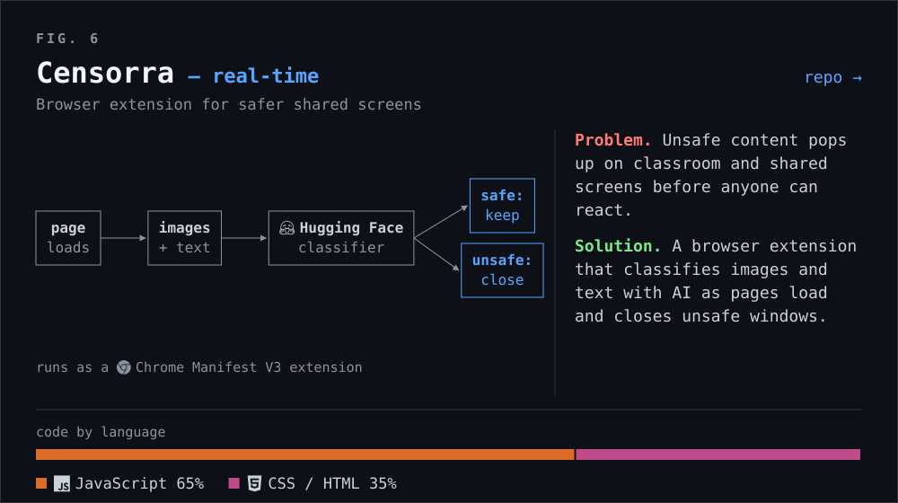
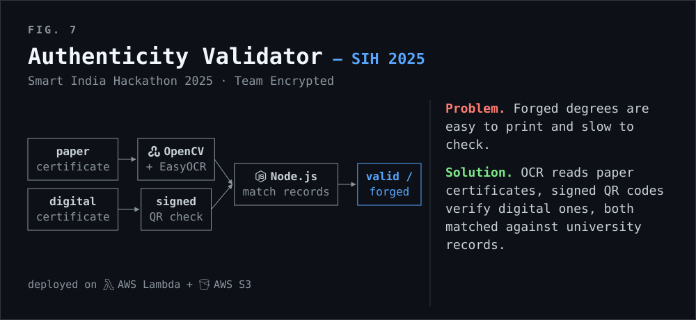
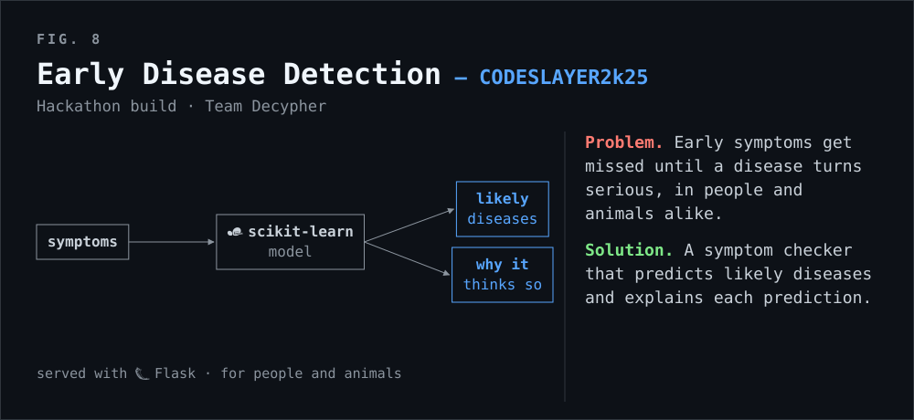

<div align="center">

<!-- =========================================================================
     TERMINAL HERO SECTION: SELF-TYPING ASCII PORTRAIT + NEOFETCH INFO CARD
     Both SVGs are 840x880 with identical terminal window styling and color themes.
     Placed side-by-side at 420px each to align seamlessly on GitHub.
     ========================================================================= -->

<h3><code>krishna@github ~ $ whoami</code></h3>

<table>
  <tr>
    <td valign="top">
      
    </td>
    <td valign="top">
      
    </td>
  </tr>
</table>

<p align="center">
  <i>Building production-grade AI platforms, satellite geospatial intelligence, and hardware-level privacy systems.</i>
</p>

<p align="center">
  <a href="https://www.linkedin.com/in/krishna-sharma-cse/"></a>
  &nbsp;
  <a href="https://www.krishna-sharma.dev/"></a>
  &nbsp;
  <a href="https://github.com/krishnasharma1493"></a>
  &nbsp;
  <a href="mailto:contactkrishna0104@gmail.com"></a>
</p>

</div>

<br>

---

### <code>krishna@github ~ $ cat tech-stack.sys</code>

#### 💻 Programming Languages & Core Systems
<p align="left">
  
  
  
  
  
  
  
  
</p>

#### 🧠 Artificial Intelligence, Machine Learning & Geospatial
<p align="left">
  
  
  
  
  
  
  
  
  
  
  
</p>

#### 🌐 Web, Mobile & Distributed Services
<p align="left">
  
  
  
  
  
  
  
  
  
  
  
</p>

#### ☁️ Cloud, Databases, Systems & Hardware
<p align="left">
  
  
  
  
  
  
  
  
  
  
</p>

<br>

---

### <code>krishna@github ~ $ ./code-stats.sh</code>



<br>

---

### <code>krishna@github ~ $ ./featured-projects.sh --verbose</code>

<div align="center">

<a href="https://github.com/krishnasharma1493/NAZAR"></a>
<br><br>
<a href="https://github.com/krishnasharma1493/IGNISSENSE"></a>
<br><br>
<a href="https://github.com/krishnasharma1493/Nyaya-Sahayak-Core"></a>
<br><br>
<a href="https://github.com/krishnasharma1493/multi-ocular-disease-detection"></a>
<br><br>
<a href="https://github.com/krishnasharma1493/Presently"></a>
<br><br>
<a href="https://github.com/krishnasharma1493/Censorra"></a>
<br><br>

<br><br>


<sub>Demos: [IGNISSENSE](https://drive.google.com/file/d/1j3GCaUA8aCcoRv1Ed7NfYEF0C_RTlZQd/view?usp=sharing) · [Nyaya-Sahayak](https://drive.google.com/file/d/1Jz7PsEeXDtInVWAkaQ_y4g_ZV-EZ7cLe/view?usp=sharing)</sub>

</div>

<br>

---

### <code>krishna@github ~ $ cat achievements.log</code>

```yaml
honors_and_hackathons:
  - award: "Finalist"
    event: "Nari Kavach 2026 (Women Safety Innovation Challenge)"
    organization: "IEEE Women in Engineering, University of Delhi"
    project: "NAZAR — Covert Wi-Fi Camera Detection Research"

  - award: "Top 15 Team"
    event: "Hack-4-Viksit Bharat"
    organization: "GeeksforGeeks × Google Cloud × SISL Infotech"
    project: "Nyaya-Sahayak — Statutory Legal First-Responder Platform"

  - award: "Selected Team"
    event: "Smart India Hackathon (SIH) 2026"
    problem_statement: "PS 26162 — Thermal Anomaly Classification"
    team_lead_system: "IGNISSENSE"

  - award: "Selected Team"
    event: "Smart India Hackathon (SIH) 2025"
    problem_statement: "PS 25029 — Academic Document Authenticity Verification"
    team: "Team Encrypted"

leadership_and_volunteering:
  - role: "Student Coordinator"
    organization: "Training & Placement Cell, Faculty of Technology, University of Delhi"
    duration: "Aug 2026 – Present"
    details: "Coordinating corporate outreach, recruitment drives, and placement logistics."

  - role: "Field Operations Volunteer"
    organization: "The Sankalp Organisation"
    duration: "Sep 2025 – Present"
    details: "Mobilizing volunteers, supporting community education and field outreach campaigns."
```

<br>

---

<div align="center">

### <code>krishna@github ~ $ ./connect.sh</code>

<p>
  Feel free to reach out for research collaborations, software engineering roles, hackathons, or open-source discussions:
</p>

[](https://www.linkedin.com/in/krishna-sharma-cse/)
&nbsp;&nbsp;
[](https://www.krishna-sharma.dev/)
&nbsp;&nbsp;
[](https://github.com/krishnasharma1493)
&nbsp;&nbsp;
[](mailto:contactkrishna0104@gmail.com)


</div>
